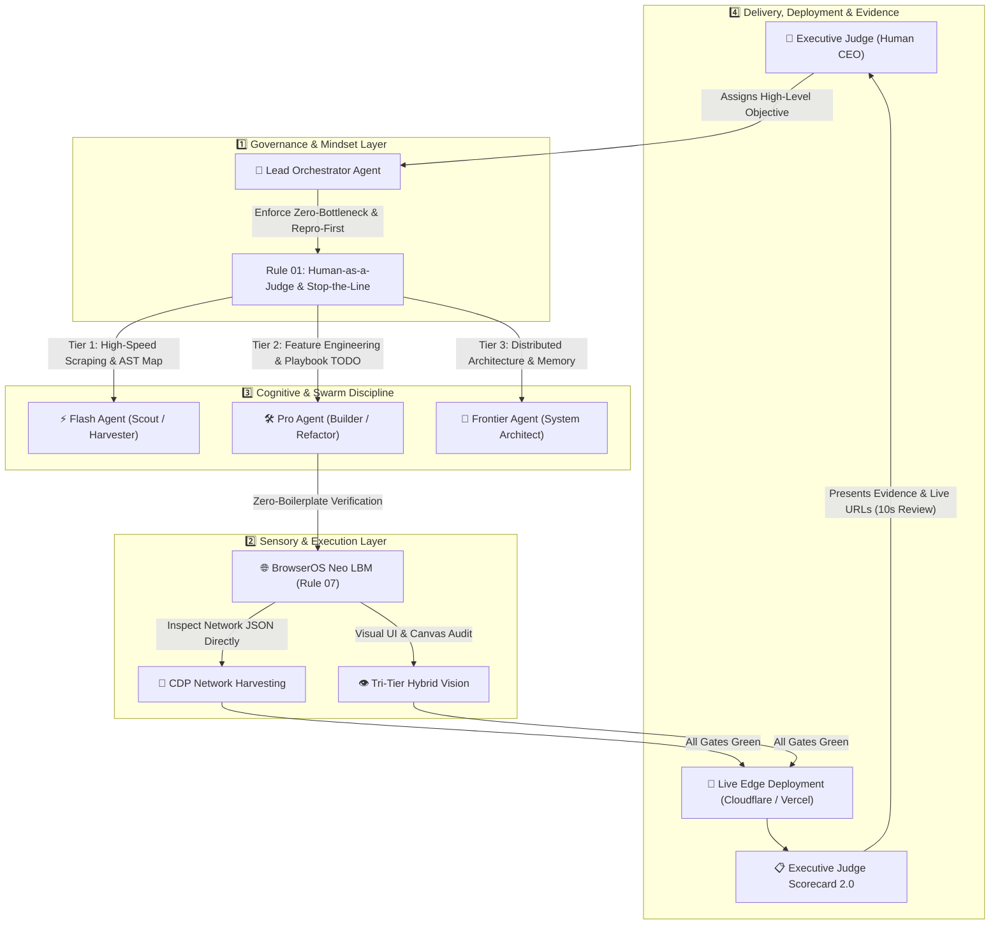

# ⚖️ Agentic CEO Protocol v2.0 — Human-as-a-Judge, Sensory Harness & Autonomous Swarm Ruleset

> **Transform your AI Coding Agents from needy junior interns into an autonomous executive engineering swarm.**  
> *เปลี่ยน AI Coding Assistant จากพนักงานฝึกงานที่คอยถามทุกฝากก้าว ให้เป็นทีมงานระดับผู้บริหาร ทำงานจบครบวงจร ตัดสินใจคม ตรวจงานจริงผ่าน Sensory Harness และรายงานผลผ่าน Executive Judge Scorecard 2.0*

[](LICENSE)
[](#)
[](#installation)

---

## 🏛️ The Paradigm Shift / ปรัชญาการเปลี่ยนกระบวนทัศน์

Inspired by **Lauren Tan** (`poteto` / `pstack`), the Agentic CEO Protocol solves the fundamental flaw of conventional AI agent interaction: **The Micromanagement Bottleneck** and **Verification Hallucination**.

```
[❌ Legacy: Human-in-the-Loop]
AI stops -> Asks "Should I write file X?" -> Human responds -> AI stops -> Asks "What color button?" -> Human fatigued.

[⚡ Agentic CEO v2.0: Human-as-a-Judge & Sensory Harness]
Human sets objective -> AI Swarm plans & parallel executes -> Repro-First verification -> BrowserOS Neo LBM live audit -> Self-heals bugs -> Deploys to live preview -> Delivers completed artifact with 10-Second Executive Scorecard.
```

| Dimension / มิติ | ❌ Legacy: Human-in-the-Loop | ⚡ Agentic CEO Protocol v2.0 |
| :--- | :--- | :--- |
| **Human Role** | Task monitor, bug spotter, step-by-step approver | **Executive Judge (ผู้พิพากษา)** deciding on final evidence |
| **Workflow Cadence** | High friction, constant ping-pong interrupts | **Zero-bottleneck autonomous batch execution** |
| **Bug Fixing Discipline** | Guess-and-modify code blindly | **Repro-First & Stop-the-Line:** Must reproduce before editing |
| **Testing Burden** | "Please check localhost:3000 to see if it works" | **Automated Sensory Verification** via BrowserOS Neo LBM CDP |
| **Scope Execution** | Drip-feeding minimal code, waiting for follow-ups | **Complete-by-default:** Self-expansion anticipating next steps |
| **Workflow Anchoring** | Ad-hoc instructions prone to context drift | **Playbook Checklist Anchors:** Literal `[ ]`, `[/]`, `[x]` tracking |
| **Memory Across Runs** | Stateless amnesia starting from scratch | **Zero-Amnesia Protocol:** Cross-session memory & handoffs |
| **Model Cost** | Expensive top-tier models used for mundane file scans | **3-Tier Smart Routing:** Flash (Scout) ➔ Pro (Workhorse) ➔ Frontier (Architect) |

---

## 🏗️ The 4-Dimensional Architecture Blueprint / สถาปัตยกรรม 4 มิติ



---

## 📜 The 8 Universal Rules / 8 กฎเหล็กสากล

The protocol consists of 8 modular rule files designed to be dropped directly into modern AI agent environments:

### 1. `01-human-as-a-judge.md` — The Zero-Bottleneck & Repro-First Protocol
- **Never Block on the Human:** Proceed autonomously on all reversible actions (code creation, refactoring, UI polish, testing). Never stop mid-workflow to ask trivial questions.
- **Repro-First & Stop-the-Line:** For bug fixes, AI must deterministically reproduce the bug in the running environment *before* modifying code. If reproduction fails, halt immediately and report to the Judge.
- **Sensory Verification:** Verify web apps through live BrowserOS Neo LBM CDP and visual inspection.
- **Pre-Ship Self-Expansion Loop:** Anticipate the human's immediate next questions. Bundle high-ROI secondary improvements into the initial release.
- **Deliver via Judge Scorecard 2.0:** End every session with a clear, 10-second readable scorecard containing *What & Why*, *Verification Proof*, *Attention Flags*, and *Live Links*.

### 2. `02-smart-model-routing.md` — 3-Tier Cognitive Allocation
Optimize speed, intelligence, and token economics by matching task complexity to the right model tier:
- **Tier 1 (`flash` / `flash-lite`):** File discovery, regex scraping, reading large raw logs, fast document search.
- **Tier 2 (`pro`):** Core application logic, REST endpoints, UI components, automated testing, standard bug fixes.
- **Tier 3 (`frontier` / `opus`):** Deep architectural trade-offs, mission-critical financial/legal logic, complex multi-agent orchestration.

### 3. `03-parallel-subagent-swarm.md` — Concurrent Specialist Delegation & Playbook Anchors
- Never execute multi-faceted tasks in a single serial queue.
- Decompose complex initiatives into isolated workstreams dispatched simultaneously across subagents (`data-harvester`, `backend-architect`, `frontend-commander`, `independent-reviewer`).
- **Playbook Checklist Anchors:** Subagents establish literal `[ ]`, `[/]`, `[x]` checklists based on standard SOPs, preventing context drift and silently dropped edge cases.

### 4. `04-credentials-and-file-safety.md` — Security & Non-Destructive Operations
- **Zero Secrets in Chat:** Strictly forbid asking for or outputting raw API keys, passwords, or production connection strings. Enforce `.env.example` templates and native secret managers.
- **Non-Destructive File Operations:** Never overwrite source input files silently. Enforce semantic versioning suffixes (`_v1`, `_v2`) for scratch data transformations.

### 5. `05-live-deployment-and-links.md` — Mandatory Live Deliverables
- Any project with frontend or API capabilities must be built and deployed directly to live staging/production preview environments (e.g. Cloudflare Pages, Vercel, Netlify).
- Never report completion without pairing commit hashes with clickable repository links and live operational URLs.

### 6. `06-cross-session-memory.md` — Cross-Session Memory & Zero-Amnesia Protocol
- **Turn-1 Auto-Recall:** Inspect active task handoffs (`memory_handoff`) and read project anchors (`PROGRESS.md`, `CONTEXT.md`) before proposing changes.
- **Google Harness² Memory Taxonomy:** Explicitly separate verified repo facts (`[WORKSPACE_FACT]`) from transferable workflows (`[DOMAIN_PROCEDURE]`).
- **4-Field Experience Schema:** Persist lessons with `Cue + Lesson + Evidence + Confidence`.

### 7. `07-browseros-neo-lbm-priority.md` — Zero-Boilerplate Verification Engine
- Mandates the use of **BrowserOS Neo LBM Edition** over legacy browser automation.
- **Zero-DOM CDP Network Harvesting:** Intercept backend JSON payloads directly through CDP, immune to CSS class changes and hydration lag.
- **Tri-Tier Hybrid Vision:** DOM-first with auto-failover to Micro-Vision for Canvas, Flutter Web, and WebGL.
- **Fast Transcript Compaction:** Evict stale DOM snapshots while keeping human-AI dialogue intact to save up to 91% context tokens.

### 8. `08-token-hygiene-and-ast-gate.md` — Token Hygiene, AST Gate & Compaction
- **Skeleton-First File Reading:** Use AST repo maps (`gk_get_repo_map`) and surgical line slicing instead of dumping large files into context.
- **Terminal Log Pruning:** Compress noisy test logs into 1-line verified status badges (`[OK] [VERIFIED]`).
- **Loop Circuit Breaker:** Immediately halt speculative full-file rewrites when user signals repeated failure (*"ยังไม่ได้"*, *"แก้ไม่หาย"*).
- **Hard AST Code Hygiene:** Enforce Cyclomatic Complexity (`CC <= 7`), Function Span (`<= 70 lines`), and zero lazy stubs.

---

## 📋 The Executive Judge Scorecard 2.0 Template

When delivering results, agents adhere to this standardized output format:

```markdown
### 📋 Judge Scorecard 2.0

1. **✅ What & Why (สิ่งที่ทำตามสั่ง + สิ่งที่คิดเผื่อให้ครบวงจร):**
   - Summary of explicit implementations and high-ROI bundled enhancements (Pre-Ship Self-Expansion).
2. **🔬 Verification Proof & Sensory Evidence (หลักฐานการทดสอบและผลตรวจจริง):**
   - Automated test suite results, exit codes, and linter checks.
   - BrowserOS Neo LBM verification: Live CDP Network response codes, payload integrity, and UI snapshot links.
3. **⚠️ Attention Flags & Invariants (จุดสังเกต):**
   - Critical observations, constraints, or `No flags (100% clean)`.
4. **🔗 Live & Repo Links (ลิงก์ระบบและซอร์สโค้ด):**
   - Direct repository link, commit hash, and live deployment preview URL (Edge/Cloudflare/Vercel).
```

---

## ⚡ 1-Click Installation / วิธีการติดตั้ง

### PowerShell (Windows)
Run from PowerShell to install into Google AntiGravity (`~/.gemini/config/rules`) and optionally Cursor (`--Cursor`):
```powershell
# Clone and install globally
git clone https://github.com/aranyuth/agentic-ceo-protocol.git
cd agentic-ceo-protocol
.\install.ps1 -Cursor
```

### Bash (macOS & Linux)
Run from terminal to install into Google AntiGravity and optionally Cursor (`--cursor`):
```bash
git clone https://github.com/aranyuth/agentic-ceo-protocol.git
cd agentic-ceo-protocol
chmod +x install.sh
./install.sh --cursor
```

### Direct Configuration Mapping
| AI Assistant / IDE | Target Directory | Method |
| :--- | :--- | :--- |
| **Google AntiGravity (AGY)** | `~/.gemini/config/rules/` | Copy `rules/*.md` directly |
| **Cursor IDE** | `~/.cursor/rules/` or `.cursor/rules/` | Copy `rules/*.md` directly |
| **Claude Code** | Root `CLAUDE.md` | Concatenate `rules/*.md` into `CLAUDE.md` |
| **Windsurf** | `.windsurfrules` | Include core rules into `.windsurfrules` |
| **OpenCode / omp** | `~/.omp/rules/` | Copy `rules/*.md` directly |

---

## 📄 License
MIT License. Created and curated for the autonomous engineering community.
